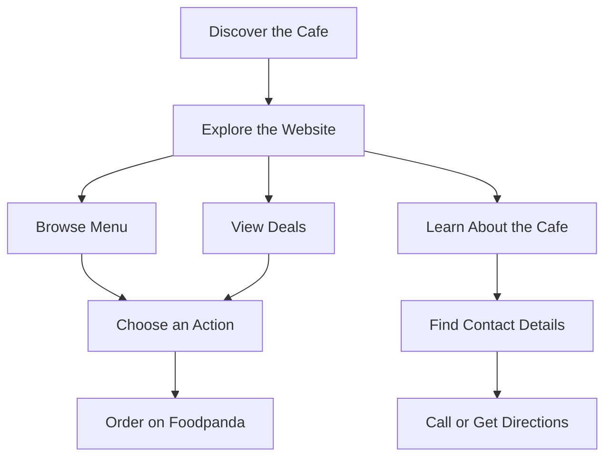
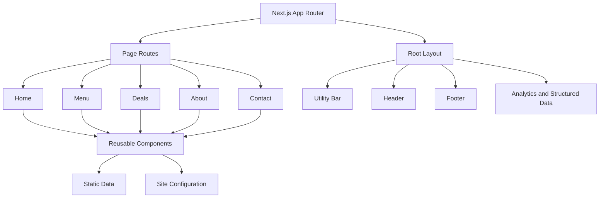
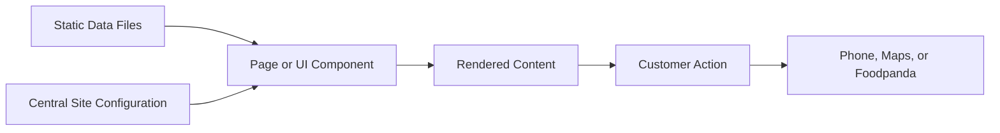

# Fast & Furious Cafe — Sialkot

A responsive restaurant website designed to help customers explore the menu, discover available deals, find the cafe, and access its online ordering platform.

**Live Website:** [fast-and-furious-cafe.vercel.app](https://fast-and-furious-cafe.vercel.app/)  
**Repository:** [hadiashah01/fast-and-furious-cafe](https://github.com/hadiashah01/fast-and-furious-cafe)  
**Location:** Circular Road, opposite Pakistan Gym, Kainchi Mohalla, Sialkot, Punjab, Pakistan

---

## Table of Contents

- [Overview](#overview)
- [Project Goals](#project-goals)
- [Features](#features)
- [Technology Stack](#technology-stack)
- [User Journey](#user-journey)
- [Application Architecture](#application-architecture)
- [Project Structure](#project-structure)
- [Static Data Architecture](#static-data-architecture)
- [SEO and Discoverability](#seo-and-discoverability)
- [Responsive Design and Accessibility](#responsive-design-and-accessibility)
- [Business Information and External Links](#business-information-and-external-links)
- [Getting Started](#getting-started)
- [Available Scripts](#available-scripts)
- [Deployment](#deployment)
- [Author](#author)

---

## Overview

Fast & Furious Cafe is a restaurant website project built around a simple objective: make essential information accessible without making customers navigate through multiple platforms.

The website brings together the cafe's menu, deals, business information, location, and external ordering destination in one responsive experience.

Instead of treating the website as a collection of disconnected pages, the implementation uses shared layout components, centralized business configuration, organized static data, and page-level metadata.

### What the website provides

- A dedicated homepage for discovering the cafe.
- A menu experience for browsing food items and prices.
- A deals page for exploring available offers.
- An About page introducing the business.
- A Contact page with location and contact information.
- Direct access to phone, map directions, and Foodpanda ordering.

## Project Goals

| Goal | Implementation |
|---|---|
| Improve discoverability | Page metadata, sitemap, robots configuration, and structured data |
| Make menu browsing straightforward | Dedicated menu page with organized item data |
| Reduce friction when ordering | External Foodpanda ordering link |
| Make contact information accessible | Clickable phone and email links, plus location information |
| Maintain consistency | Shared components and centralized business configuration |
| Support different devices | Responsive layouts and utility-based styling |
| Keep the code maintainable | Separated pages, components, configuration, and data |

## Features

### Customer Experience

- **Homepage:** Introduces the cafe and directs visitors toward key actions.
- **Menu browsing:** Displays menu items and their associated information.
- **Deals:** Presents available deals and combo information.
- **About:** Provides business information and context.
- **Contact and location:** Helps visitors find the cafe and access its contact details.
- **Online ordering:** Links customers to the cafe's Foodpanda listing.
- **Direct contact:** Uses clickable phone and email links where provided.
- **Shared navigation and footer:** Keeps primary navigation and business information consistent across pages.

### Technical Features

- Next.js App Router with file-based routing.
- Reusable React components.
- TypeScript support.
- Tailwind CSS styling.
- Centralized business configuration and static content.
- Page-specific SEO metadata.
- Open Graph and Twitter card metadata.
- JSON-LD structured data for the website and restaurant.
- Robots and sitemap routes.
- Vercel Analytics integration.
- Production build and lint checks.

## Technology Stack

| Technology | Purpose |
|---|---|
| Next.js | Application framework, routing, metadata, and static rendering |
| React | Component-based user interface |
| TypeScript | Type-aware development |
| Tailwind CSS | Responsive styling and layout utilities |
| ESLint | Code quality and lint checks |
| Vercel | Hosting and deployment |
| Vercel Analytics | Website analytics integration |
| Schema.org JSON-LD | Structured business and website information |

## User Journey

The primary journey is designed to move visitors from discovering the cafe to taking a useful action.



This flow keeps the main customer actions clear: explore food, review available offers, order externally, or find the cafe.

## Application Architecture

The application separates routing, reusable UI, business configuration, and static content. This keeps page components focused on presentation while shared information remains easier to maintain.



### Architectural decisions

- **App Router:** Page routes follow the Next.js `app/` directory convention.
- **Shared layout:** Common navigation, utility information, and footer content are managed through the root layout.
- **Separation of concerns:** Components, data, and business configuration have distinct responsibilities.
- **Static content:** Menu and deal information is maintained in project files rather than requiring a live database for every page view.
- **Metadata configuration:** Shared metadata utilities reduce duplication between page definitions.

## Project Structure

The main application areas are organized by responsibility.

```text
fast-and-furious-cafe/
├── app/
│   ├── about/
│   │   └── page.tsx
│   ├── contact/
│   │   └── page.tsx
│   ├── deals/
│   │   └── page.tsx
│   ├── menu/
│   │   └── page.tsx
│   ├── components/
│   │   ├── Header.tsx
│   │   ├── Footer.tsx
│   │   ├── TopUtilityBar.tsx
│   │   └── ...
│   ├── config/
│   │   ├── metadata.ts
│   │   └── site.ts
│   ├── data/
│   │   └── ...
│   ├── globals.css
│   ├── layout.tsx
│   ├── page.tsx
│   ├── robots.ts
│   └── sitemap.ts
├── public/
│   ├── images/
│   └── ...
├── package.json
├── next.config.ts
├── tsconfig.json
└── README.md
```

### Key directories

| Path | Responsibility |
|---|---|
| `app/` | Application routes and root layout |
| `app/components/` | Shared and page-level UI components |
| `app/config/` | Central business settings and metadata utilities |
| `app/data/` | Static menu, deal, and other content |
| `public/` | Publicly served images and other assets |
| `app/robots.ts` | Robots.txt generation |
| `app/sitemap.ts` | Sitemap generation |

## Static Data Architecture

Menu and deal content is intentionally maintained as static project data. This keeps the implementation straightforward and avoids introducing a database or API dependency when the content does not require one.



### Why this approach?

- Content can be reviewed and updated directly in the repository.
- Business details can be shared across relevant components.
- Rendering does not depend on a remote content API.
- The implementation remains suitable for a small business website with a manageable content catalogue.


## SEO and Discoverability

Search engine discoverability is supported through metadata, crawl-related routes, and structured business information.

### Metadata

- Descriptive page titles and meta descriptions.
- A shared title template.
- Canonical URL support through the metadata utility.
- Open Graph metadata for social sharing.
- Twitter card metadata.
- A configured metadata base
- Google Search Console verification completed.

### Technical SEO

- `app/robots.ts` provides the robots route.
- `app/sitemap.ts` provides the sitemap route.
- JSON-LD structured data describes the website and restaurant.
- Semantic page structure supports content interpretation.
- Menu items are rendered as website content rather than relying exclusively on a menu image.

### Local discoverability

The website includes the cafe's location and contact information to help visitors identify the business and find directions.

## Responsive Design and Accessibility

The interface uses Tailwind CSS utility classes to build layouts for different viewport sizes.

Implementation priorities include:

- Responsive navigation and page layouts.
- Readable typography and content hierarchy.
- Clear actions for menu browsing, contact, directions, and ordering.
- Meaningful image alternative text.
- Descriptive labels for embedded maps and interactive controls.
- Keyboard accessibility and visible focus states.


## Business Information and External Links

| Detail | Information |
|---|---|
| Business | Fast and Furious Cafe |
| Location | Circular Road, opposite Pakistan Gym, Kainchi Mohalla, Sialkot, Punjab, Pakistan |
| Phone | [0332 4340149](tel:03324340149) |
| Email | [ffcafesialkot@gmail.com](mailto:ffcafesialkot@gmail.com) |
| Ordering | [Foodpanda restaurant listing](https://www.foodpanda.pk/restaurant/iwe2/fast-and-furious-cafe) |
| Directions | [Open Google Maps](https://maps.app.goo.gl/9yxoKTfZJWTQJ8sT7) |


## Getting Started

### Prerequisites

- Node.js compatible with the installed Next.js version.
- npm.
- Git.

### 1. Clone the repository

```bash
git clone https://github.com/hadiashah01/fast-and-furious-cafe.git
cd fast-and-furious-cafe
```

### 2. Install dependencies

```bash
npm install
```

### 3. Start the development server

```bash
npm run dev
```

Open [http://localhost:3000](http://localhost:3000) in your browser.

## Available Scripts

| Command | Purpose |
|---|---|
| `npm run dev` | Start the development server |
| `npm run lint` | Run ESLint |
| `npm run build` | Compile and generate the production build |
| `npm run start` | Start the production server after building |

## Deployment

The project is configured for deployment on Vercel.


### Production verification

```bash
npm run lint
npm run build
```


## Author

**Hadia Shahjahan** — Frontend Developer

- GitHub: [@hadiashah01](https://github.com/hadiashah01)
- LinkedIn: [Hadia Shahjahan](https://www.linkedin.com/in/hadia-shahjahan/)

This project demonstrates responsive interface development, reusable component architecture, static content organization, technical SEO foundations, and deployment of a business-focused website using Next.js and Tailwind CSS.
